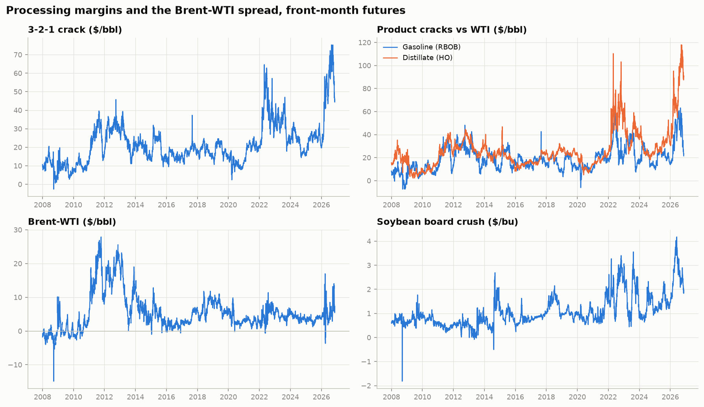
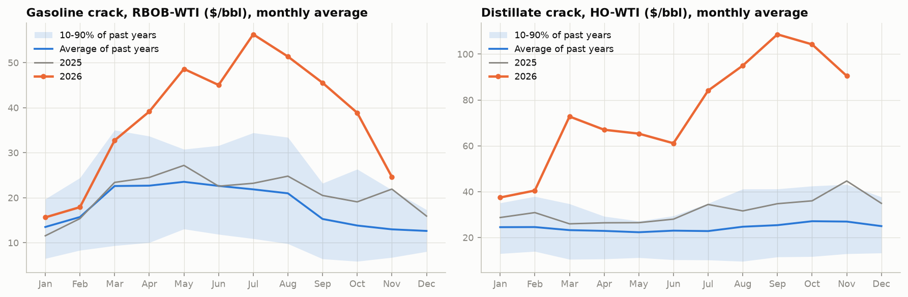
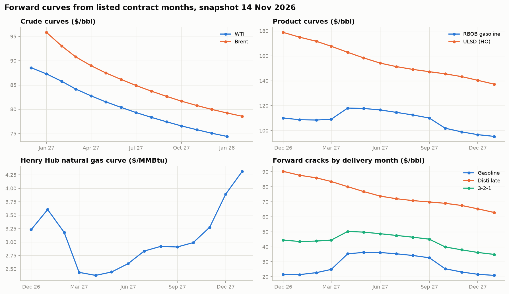
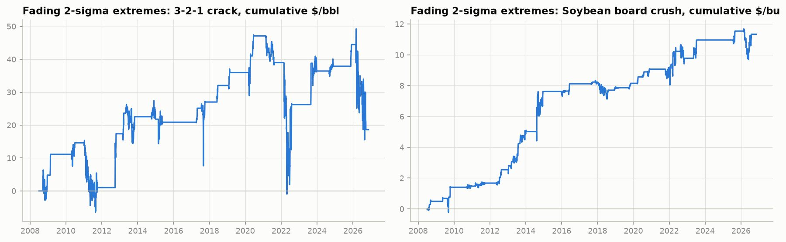

# commodity-spread-tracker

Flat price gets the headlines, but a refinery or a crush plant doesn't care much whether crude is at 60 or 90. It cares about the margin between what goes in and what comes out. This repo tracks those margins from futures prices, checks how unusual they are, and looks at the forward curve behind them.

One command, free data (Yahoo Finance), no API key.

```bash
pip install -r requirements.txt
python run.py        # writes figures/ and results/latest.md
pytest               # unit conversions + look-ahead checks
```

## What it tracks

| Spread | Formula | Unit |
|---|---|---|
| Gasoline crack | RBOB × 42 − WTI | $/bbl |
| Distillate crack | HO × 42 − WTI | $/bbl |
| 3-2-1 crack | (2 × RBOB × 42 + HO × 42 − 3 × WTI) / 3 | $/bbl |
| Brent-WTI | Brent − WTI | $/bbl |
| Soybean board crush | meal × 0.022 + oil × 0.11 − beans | $/bu |

The conversions are the boring part and also where it goes wrong most often: products trade in $/gal (42 gal per barrel), meal in $/short ton, oil in ¢/lb, beans in ¢/bu. A bushel gives about 44 lb of meal and 11 lb of oil, which is where 0.022 and 0.11 come from. They're unit-tested in `tests/`.



## Is a spread actually unusual?

I compute two z-scores, and they disagree more often than I expected.

- **vs. the trailing year**: simple, but a gasoline crack is supposed to be higher in May than in December, so this partly just measures the calendar.
- **vs. the same calendar month in earlier years** (only earlier years, so no look-ahead): this is the one I'd trust for anything with a driving or heating season.

Snapshot from 13 Nov 2026: the 3-2-1 crack sat at $44/bbl. Against its own last year that's a z of −0.2, nothing to see. Against past Novembers it's +3.1. Same number, opposite conclusion. The distillate crack is the reason, the chart on the right shows how far outside the historical band this year has been.



## Forward curves from real contract months

Free "continuous" futures series only give you the front month, so most hobby projects guess contango/backwardation from price trends. That's not what curve structure is. Here the curve is built from the individual listed contracts (CLZ26, CLF27, ...), which gives real time spreads and roll yields.



Things you can read off it:

- **Crude is backwardated**: prompt barrels are worth more than deferred ones, the classic sign of a tight physical market. A long position earns the roll.
- **The RBOB curve steps up in April.** That's not a view on demand, it's the switch to summer-grade gasoline (lower vapour pressure, more expensive to blend). It shows up in the forward gasoline crack too.
- **Natural gas is all seasonality**: winter premium, then a cliff into spring. The March-April spread is the one people watch, it prices the risk of storage running low before injections start. Calling the gas curve "contango" from M1-M2 would be meaningless, so the code labels it as seasonal instead.
- **Forward cracks line up delivery months properly.** With front-month series you can't: CL expires around the 20th, RB and HO at month end, so for the last third of every month "front crude" and "front gasoline" are different delivery months.

Yahoo only serves contracts that are still alive, so there's no curve history. Every run saves a snapshot to `results/curve_snapshots/`, so running it daily builds one.

## Does fading extremes work?

Fixed rules, nothing fitted: enter when the spread is more than 2 sigma from its trailing-year mean, exit when it's back within 0.5, or after 60 days. Costs included.

| | trades | hit rate | total P&L | max drawdown | worst trade |
|---|---|---|---|---|---|
| Board crush ($/bu) | 41 | 80% | +10.5 | −2.0 | −1.2 |
| 3-2-1 crack ($/bbl) | 29 | 62% | +14.3 | −48.4 | −24.3 |



Crush mean-reverts fairly reliably, and the result holds across every window/threshold combination I tried (table in `results/latest.md`). Makes sense: if the margin is fat, plants run harder, meal and oil supply goes up, margin comes back.

The crack is a different story. Total P&L is positive but the drawdown is more than three times the total gain, and half the trades end on the time stop instead of reverting. When refining margins blow out it's usually structural (2022, and again this year), and capacity can't respond in 60 days. Fading that is how you lose money slowly and then quickly. So: no edge I'd claim there, and I think that's the more useful finding.

## Limits

- Front-month continuous series include roll days, so the backtest P&L is contaminated around expiries. It's a "is there something here" check, not a tradeable result.
- Board crush is the textbook yield. Real plants have their own yields, basis and energy costs.
- These are paper margins on benchmark grades. A real refinery margin depends on crude slate, yields and location.
- I left out the spark spread on purpose. It needs hourly power prices, and I didn't want to fake it with a proxy.

## Layout

```
spreadtracker/
  data.py       prices + live contract-month curves
  spreads.py    the formulas
  signals.py    rolling and seasonal z-scores
  curves.py     time spreads, roll yield, forward cracks
  backtest.py   the mean-reversion check
  plots.py
run.py          runs everything
results/        latest report, spread history, trade logs, curve snapshots
```

Not investment advice, just me trying to understand how these margins behave.
